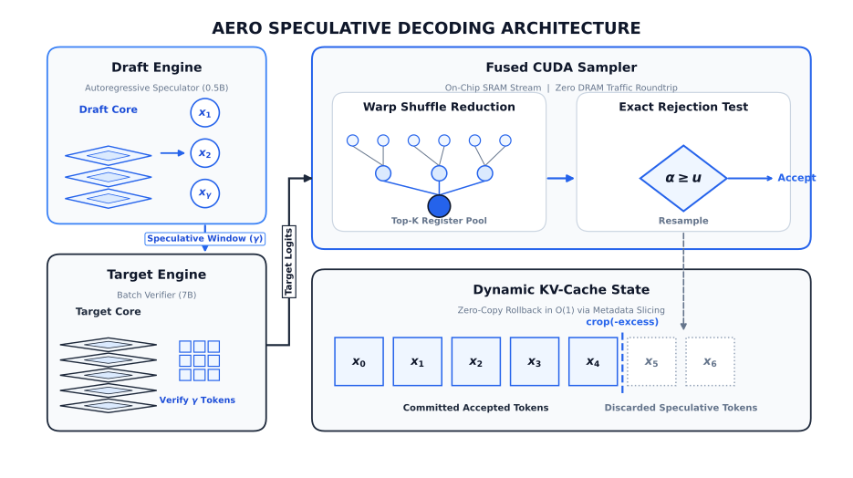

<div align="center">

# Aero

**Draft-model speculative decoding with a fused CUDA sampling kernel.**

[Overview](#overview) · [Architecture](#architecture) · [Results](#results) · [Next steps](#next-steps) · [Usage](#usage)


</div>

---

## Overview

Aero is a research prototype of draft-model speculative decoding on a single consumer GPU (RTX 4090 D). Qwen2.5-0.5B-Instruct drafts tokens and Qwen2.5-7B-Instruct verifies them.

* **Fused sampling kernel (CUDA).** A two-stage top-k / top-p sampler: each block pre-selects candidates from its shard of the 151,936-token vocabulary, then a refinement stage picks the final token. Intermediate results stay in shared memory and registers (warp-shuffle reductions) instead of being written back to global memory as separate tensors.
* **Lossless verification.** Standard speculative rejection sampling: accept a draft token with probability min(1, p/q), otherwise resample from the normalized residual max(0, p − q). The output distribution equals the target model's; with greedy decoding the output matches the target model token for token.
* **KV-cache rollback.** Rejected draft tokens are dropped by cropping the cache (`excess = γ − accepted`) without reallocating buffers.
* **Adaptive draft length.** γ is adjusted from a 5-round sliding window of acceptance rates with two thresholds (0.75 / 0.40).

---

## Architecture

<div align="center">
  
</div>

---

## Results

**Setup.** One RTX 4090 D (24 GB, sm_89), driver 580.76, CUDA 13.0, PyTorch 2.13, Transformers 5.17. Target Qwen2.5-7B-Instruct and draft Qwen2.5-0.5B-Instruct, both FP16.

### Sampling kernel

Measured with `benchmarks/bench_sampling.py`: batch 1, fp32 logits over 151,936 tokens, top-k 50, top-p 0.9.

| Implementation | Latency per sampling call | Intermediate tensor traffic |
|---|---|---|
| PyTorch sampling ops (top-k, softmax, multinomial, ...) | 2364.9 µs | 6.37 MB per token |
| Aero fused kernel | 229.9 µs (10.3× faster) | 0.10 MB per token |

The traffic column counts intermediate tensors only; the logits themselves (about 0.6 MB per row) are still read once.

### Acceptance rate and accepted length

6 hand-picked prompts (2 code, 1 math, 1 reasoning, 1 chat, 1 technical; 18 to 32 prompt tokens), 128 new tokens each, top-k 50, top-p 0.9, temperature 0, 2 warm-up runs and 3 measured runs per configuration (run `aero_bench_20260912_093120`).

| Draft length | Acceptance rate | Mean accepted length τ |
|---|---|---|
| γ = 2 | 71.8% | 2.41 |
| γ = 3 | 66.7% | 2.95 |
| γ = 4 | 58.9% | 3.32 |
| γ = 5 | 54.2% | 3.62 |
| γ = 6 | 51.4% | 4.00 |
| γ = 8 | 44.5% | 4.37 |
| Adaptive | 61.6% | 3.45 |

Longer drafts raise τ but lower the per-token acceptance rate; the adaptive controller settles between the two.

---

## Next steps

* End-to-end throughput: verify `[next_token, d1 … dγ]` in a single target pass, and capture the draft model with a static KV cache and CUDA Graphs.
* Profile the sampling kernel with Nsight Compute and compare it with FlashInfer's sorting-free sampling kernels.
* Make the γ controller load-aware for batched serving, where extra verified tokens stop being free once decoding becomes compute-bound.
* Evaluate on newer models with EAGLE-3 or MTP drafting.

---

## Usage

```bash
git clone https://github.com/Leonn-Liu/Aero.git && cd Aero
pip install -e .
```

```python
from aero.models import HuggingFaceRunner
from aero.runtime import SpeculativeEngine

draft = HuggingFaceRunner("Qwen/Qwen2.5-0.5B-Instruct")
target = HuggingFaceRunner("Qwen/Qwen2.5-7B-Instruct")
engine = SpeculativeEngine(draft, target, adaptive_gamma=True)
print(engine.generate("Explain quantum computing in one sentence:", max_new_tokens=64))
```

End-to-end benchmark (writes raw JSON, CSV and a Markdown report):

```bash
python benchmarks/run_cloud_suite.py \
  --target Qwen/Qwen2.5-7B-Instruct --draft Qwen/Qwen2.5-0.5B-Instruct \
  --gamma_list 2 3 4 5 6 8 --max_tokens 128 --repeats 3
```
